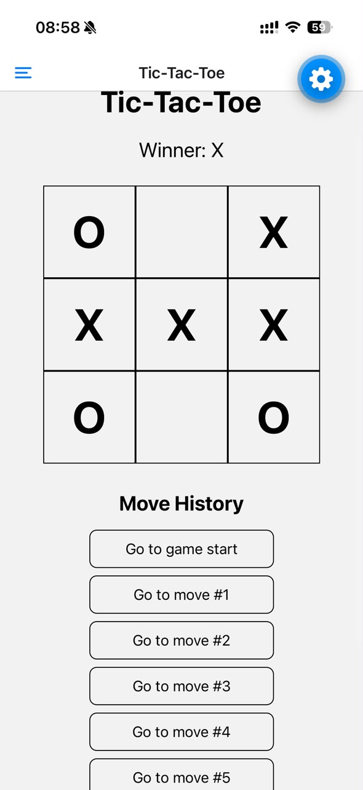
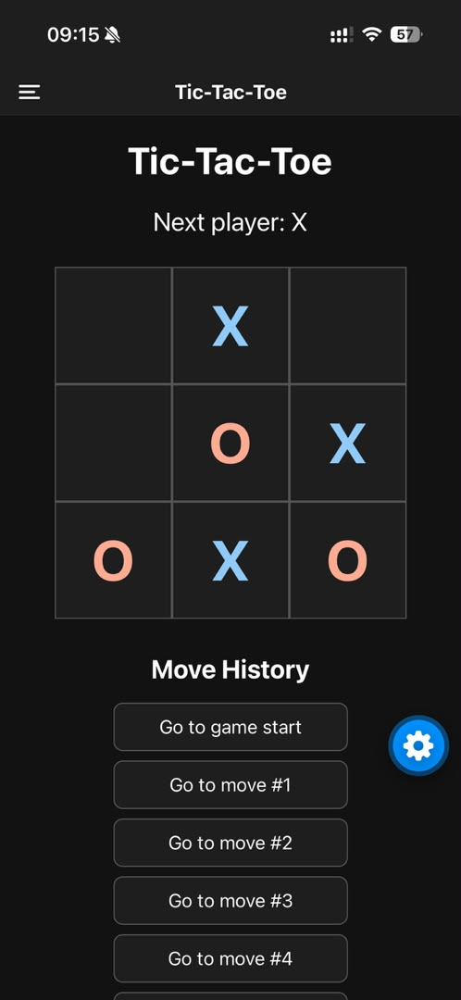

# Tic-Tac-Toe — Lab 10

A mobile Tic-Tac-Toe application developed using React Native, Expo SDK 58, and Expo Router.

The application allows two players to play Tic-Tac-Toe, revisit previous moves, and switch between light and dark themes.

## Features

- **Tic-Tac-Toe Game:** Interactive 3×3 board with alternating X and O turns, winner detection, and draw detection.
- **Move History:** Players can revisit previous moves and continue playing from an earlier position.
- **Drawer Navigation:** Three screens — Game, Settings, and About — accessible through the navigation drawer.
- **Light and Dark Themes:** A switch in Settings updates the appearance of the entire application.
- **React Context:** A shared theme provider maintains consistent appearance across screens.
- **About Screen:** Displays the application name, version, and developer information.
- **Drawer Icons:** Each navigation item has an icon that adapts to the current theme.

## Screenshots

### Light Mode



### Dark Mode



## Technologies Used

- React Native
- Expo SDK 58
- Expo Router
- TypeScript
- React Context API
- React Native Gesture Handler
- React Native Reanimated
- Expo Vector Icons

## Getting Started

**1. Clone the repository**

```bash
git clone <repository-url>
cd tic-tac-toe
```

Replace `<repository-url>` with the actual GitHub repository URL.

**2. Install dependencies**

```bash
npm install
```

**3. Start the development server**

```bash
npx expo start
```

**4. Run the application**

Scan the QR code using Expo Go on a compatible mobile device.

## How to Use

1. Open Game and tap any empty square to place X or O.
2. Continue playing until a player wins or the game ends in a draw.
3. Use Move History to revisit earlier positions.
4. Open the navigation drawer to access Settings or About.
5. Enable or disable Dark Mode in Settings to change the application theme.

## Project Structure

```text
src/
├── app/
│   ├── _layout.tsx
│   ├── index.tsx
│   ├── settings.tsx
│   └── about.tsx
└── context/
    └── ThemeContext.tsx
```

## Author

Ousmane Soumaré

## Course

Mobile Development — Lab 10: A Drawer and a Dark Theme for Tic-Tac-Toe.